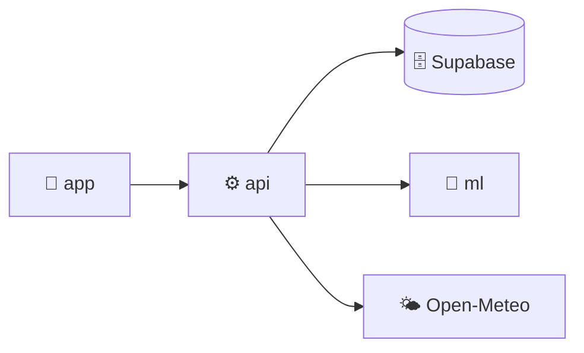

# DolabımAI

**Yapay zekâ destekli kişisel dolap ve kombin asistanı**

Kıyafetlerinin fotoğrafını çek; DolabımAI türünü ve rengini tanısın,
hava durumuna ve gideceğin etkinliğe göre sana kombin önersin,
seçimlerinden öğrenerek her gün biraz daha senin tarzına yaklaşsın.

---

##  Neler yapıyor?

-  **Otomatik etiketleme:** Yüklenen fotoğraftan kıyafetin alt türü (FashionCLIP), rengi ve tonu (renk analizi) çıkarılır.
-  **Hava ve etkinliğe uygun kombin:** Günün sıcaklığı, yağış durumu ve etkinlik türüne göre dolabındaki parçalardan kombin oluşturulur.
-  **Senden öğrenen öneriler:** Her kullanıcı için ayrı bir model, beğendiğin ve seçtiğin kombinlerden tarzını öğrenir.
-  **Parça değiştirme:** Önerilen kombindeki tek bir parçayı uyumlu bir alternatifle değiştirebilirsin.

##  Repolar

| Repo | Açıklama | Teknoloji |
|------|----------|-----------|
| [**app**](https://github.com/DolabimAI/app) | Mobil uygulama ve web sürümü | React Native, Expo |
| [**api**](https://github.com/DolabimAI/api) | Ana sunucu, veri tabanına yazan tek katman | C#, .NET |
| [**ml**](https://github.com/DolabimAI/ml) | Görüntü analizi ve öneri servisi | Python, FastAPI, FashionCLIP, scikit-learn |

##  Mimari

---

Doğuş Üniversitesi · Yazılım Mühendisliği · YM 491/Araştırma Projesi

